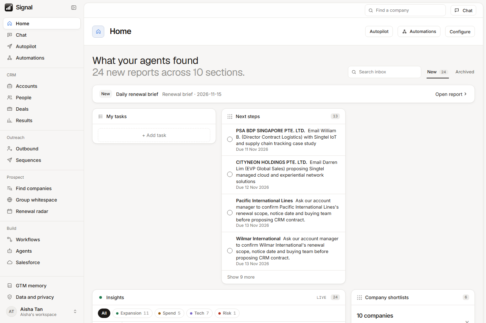
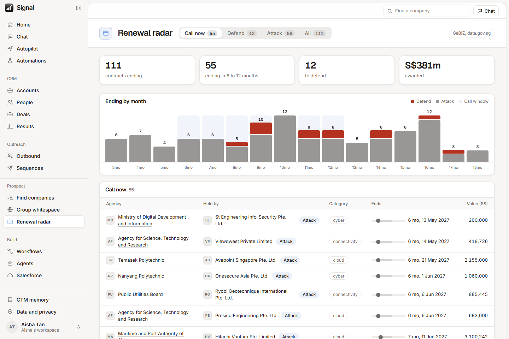

# Signal

Signal tells a sales team which company to call, when, and why. It reads public news, stock exchange filings, company registries and government contract awards every day. From that it works out which companies are about to need something, and gives each seller a short morning list: who to call, the reason to call now with its source, a way in, and a draft message to approve.

We built it as a team of six for the problem statement Singtel set at the Singapore-India Hackathon 2026, held at Singapore Management University. It placed first in Emerging Tech.

Live app: https://signal-sellers.vercel.app

## This repo is one part of a bigger project

The full app is about 35,000 lines with 690 tests, and its repo is private. We built it as an internal tool for Singtel's enterprise sellers, so it is set up around Singtel's products, rivals and accounts. We are now working on a general version that any sales team can point at its own market and its own data.

Until that is out, this repo holds the modules I think are the most interesting to read: the background research agent, the chat agent, the scoring engine, the company graph, and the code we used to prove it works. They are copied as they are from the main repo. They import modules that are not here, so this repo is for reading and is not meant to run on its own. To see it running, use the live app.

We built it together and did not split the work by file. My own time went mostly into the data sources, the scoring and the back-test, and the tools the chat agent uses to look things up.

## What is in here

| File | What it does |
|---|---|
| `agents/revenue.py` | Background research agent. A seller approves a goal once, and a worker keeps going after the browser closes. |
| `agents/revenue_contacts.py` | Finding a person to write to. Free search first. A paid lookup needs its own approval. |
| `agents/revenue_profile.py` | Checks the research the model wrote against the documents it was given. |
| `agents/thread.py` | "Ask Signal", the chat agent. 24 tools over the company graph and the app database. |
| `agents/llm.py` | Every model call goes through here: Claude or Gemini, structured output, one shared daily budget. |
| `agents/gtm.py` | The team's shared sales playbook. Agents suggest changes and a person approves them. |
| `backend/engine.py` | Turns signals into a score per company and product, and decides when not to call. |
| `backend/catalog.py` | The settings the engine reads: signal types, weights, products, time windows. |
| `backend/kg.py` | Resolves a typed or misspelt name to the right company among 2.1 million, and finds how two companies connect. |
| `backend/knowledge.py` | Fetches public pages and annual reports safely and stores them per company. |
| `backend/filings.py` | Reads filings from four stock exchanges (NSE, BSE, SGX, ASX). |
| `backend/collect.py` | News in five locales, government contract awards and new company registrations. |
| `backend/proof.py`, `backend/model.py` | The back-tests and the win-probability model. |
| `tests/` | The tests for these modules. They need the full repo and a Postgres database to run. |
| `eval/labels.csv` | 163 hand-labelled news items and filings (plus 34 synthetic ones) used to score the signal tagger. |

## How the interesting parts work

### An agent that survives a restart

A seller types or says something like "every morning at 9, bring me ten new logistics companies, research them and draft an email for each". After one approval, the work runs on a separate worker process. Nothing runs inside a web request.

Each company moves through four stages: collect, people, research, draft. The state of every stage is saved in Postgres, so a crash or a deploy loses nothing. The parts worth reading in `agents/revenue.py`:

- `claim` picks the next job with `FOR UPDATE SKIP LOCKED` and gives it a random token and a 5-minute lease. Two workers never take the same job.
- `Heartbeat` renews the lease every 20 seconds while the slow work runs (fetching pages, calling the model).
- `_fence` runs before every save. If the lease expired or the seller pressed Stop, the worker's token no longer matches and its result is thrown away. This stops a slow worker from overwriting newer work.
- `fail` retries a stage up to 3 times with a growing wait. Error text shown to the seller never includes URLs or model output, since those can carry credentials or untrusted text.

### No claim without a matching quote

The model is not trusted to cite correctly. Every fact it writes must name a source document and quote it. `validate_claims` then checks that the quote appears in that document as one continuous passage, ignoring only case and spacing. If any quote fails, the whole answer is rejected and the stage is retried with the error passed back to the model.

The model also never writes links or email addresses. It returns ids, and the code looks up the real values in the database. A draft email with a URL or an address in the body is rejected (`perform`, the draft stage).

### Spending needs a person

Every model call reserves a slot against one daily cap before it runs (`llm._reserve_budget`), so a loop cannot run up a bill overnight. Paid contact lookups are stricter. An approval covers one person at one company and at most one credit, and it expires. If a paid request times out and we cannot tell whether it went through, it is never retried automatically (`agents/revenue_contacts.py`).

### A chat agent that cannot crash the turn

`agents/thread.py` runs a tool loop of up to 8 rounds. The model calls plain Python functions named `_tool_<name>`. `call` is the only way in and it never raises: an unknown tool, bad arguments or an unknown company all come back as JSON the model can read and recover from. Every result is cut to 6,000 characters with a note saying how much was left out.

Anything that spends credits or queues drafts in bulk posts an approval card and ends the turn. `decide` makes sure only the first click acts, so a double click does nothing twice.

### Finding the right company

Sellers type "DBS", "Comfort Delgro" or a misspelling. `backend/kg.py` has to land on one legal entity among 2.1 million Singapore registrations. `resolve` tries exact ids and names first, then former names and hand-kept aliases. For typos it takes the rarest three-letter chunks of the query to get a small candidate list, then keeps the ones within one edit (`osa`, which also counts two swapped letters as one edit). `path` finds the shortest chain of ownership and people links between two companies. That is how a card can say who could introduce you.

### Fetching pages without trusting them

The research agent visits company websites it has never seen. `knowledge.fetch` resolves the hostname, checks that the address is public, and connects to that exact address, so a site cannot point us at an internal service. Each redirect is checked the same way. `extract_pdf` reads annual reports under limits on size, pages, memory, CPU and time, because a PDF from the internet can be built to hang a parser.

### The score

`backend/engine.py` gives every company and product a score from four parts, each between 0 and 1: fit, intent, timing and relationship. The score is their geometric mean, so one weak part pulls the whole score down. All four are shown on the card.

Intent combines the company's signals. Each signal has a weight for each product, its confidence, and a recency that halves about every six weeks. The weights start from a table in `catalog.py` and move with feedback: a card marked useful or a deal won pushes the weight up, and a dismissed card or a lost deal pushes it down (`weights`).

`held` handles the reasons not to call. A takeover or a wind-up holds every card for six months. A contract just signed with a rival holds that product until nine months before it is likely to end.

## Does it work

We did not want to claim it works because the demo looked good, so `backend/proof.py` tests it on history.

The main test uses Singapore government contract awards, which are open data. For every tender the Singtel group won since 2023, it finds the earlier contract that tender renewed (same agency, similar description). Then it asks whether our renewal radar would have flagged that contract before the award, using only data dated before the award.

It flagged 14 of 19 renewals, a median of 6.5 months early.

Two honest notes on that number. We widened the radar from 18 to 21 months after seeing that four renewals were awarded just outside the 18-month window, so the window was tuned on these same 19 tenders. And the radar is a list to check, since about one in three of its past flags (34%) was followed by a similar award. The hosted app still runs the 18-month window, which catches 10 of the 19.

`backend/model.py` is a small logistic regression that estimates the chance of winning a tender. It is trained on awards before July 2024 and tested on awards after, and its features only use awards dated before each tender.

The signal tagger is scored against `eval/labels.csv`.

## What is not here

The web app and its templates, the Android app, the workflow builder, outbound sequences, Salesforce sync, the database layer and the seed data. They are in the main repo.

## Stack

Python 3.12, FastAPI, Jinja, Postgres (Supabase), SQLite for the registry graph, the Claude and Gemini APIs, scikit-learn, `curl_cffi` and `pypdf`. Only public data and licensed contact data are used.

## Team

Saksham Tiwari, Bhavya Sangal, Brandon Ng, Mohammed Rayhan, Darshith Shetty and me, Jashwanth Valurouthu.
